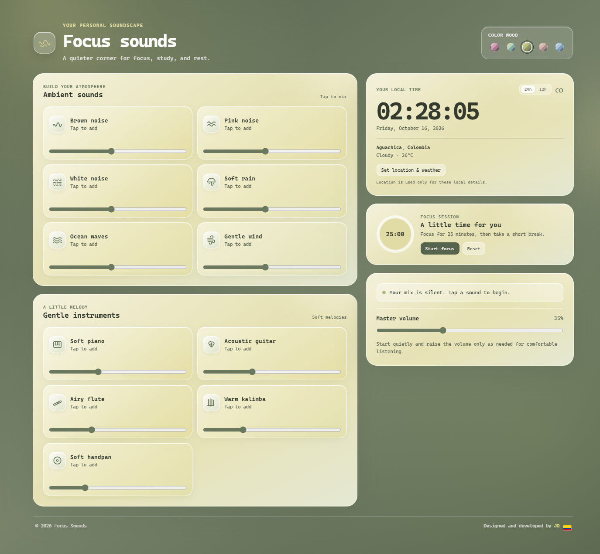

# Focus Sounds

A calm browser-based study companion for university students: ambient soundscapes, a reliable focus timer, an academic planner built from your syllabi, notes, flashcards and a customizable study companion — in English, Spanish and Portuguese.



## Features

- **Today** — what is due, what to study next (with the reasons), and how you are progressing.
- **Focus** — Pomodoro, custom and free-focus sessions linked to tasks; pauses and interruptions are recorded; sessions survive reloads and are recorded once even with several tabs open.
- **Sounds** — brown, pink and white noise, rain, ocean, wind, rain on the window, river, forest birds, café murmur, quiet library and five procedural instruments. Mix them, save soundscapes, stop everything with one click. All audio is synthesized on your device.
- **Import** — paste a syllabus or pick a PDF/TXT. Activities, exams, grade weights, dates and class times are extracted with page references; you review, edit, approve, reject or postpone each item before anything is created. Deadlines are converted from the document's time zone (e.g. Bolivia, UTC−4) to yours.
- **Tasks** — Kanban board (To organize → Completed), list and calendar views, subtasks, subject colors.
- **Plan** — study sessions distributed before each deadline around classes and commitments, with conflict warnings. Approved or edited sessions are never moved.
- **Subjects** — colors, instructors, class schedules, topics, academic periods and progress.
- **Study** — notes with autosave and page references, flashcards with spaced repetition (SM-2), flashcard drafts from notes.
- **Companion** — five original characters (Colombia, Mexico, Argentina, Brazil, Bolivia) with outfits and items unlocked by real study activity. They react to focus, breaks and completed tasks.
- **Progress** — measured study time per day, subject and task, estimate vs. actual, flashcard progress, session history and your own soundscape ratings.
- Five color moods, light/dark appearance, optional notifications and motivational messages.

## Run locally

No build step is required. Either open `index.html` directly, or use the bundled zero-dependency server (recommended for audio and PDF import):

```bash
npm start
```

Then open <http://localhost:5173>. Node.js 21 or newer is needed only for the scripts below.

## Checks

```bash
npm test
```

```bash
npm run lint
```

`npm test` runs the domain tests with Node's built-in test runner. `npm run lint` syntax-checks every script and verifies that all three languages define the same translation keys.

## Your data

Everything is stored in your browser (`localStorage`). Use **Settings → Export backup** to move data to another device. Google sign-in, cloud sync and Google Drive import are not available yet — see [docs/INTEGRATIONS.md](./docs/INTEGRATIONS.md).

## Project structure

| Path | Purpose |
| --- | --- |
| `js/core/` | Versioned store, i18n runtime and the English/Spanish/Portuguese strings |
| `js/domain/` | Pure logic with unit tests: focus sessions, scheduler, syllabus parser, time zones, flashcards, tasks, insights, companions |
| `js/ui/` | Views (one file per screen), companion artwork and DOM helpers |
| `js/*.js` | Original audio engine, mixer, clock and theme picker |
| `tests/` | `node --test` suites |
| `docs/` | Audit report and integration notes |

## License

Released under the [MIT License](./LICENSE). Companion artwork is original and part of this repository.

Designed and developed by [JD](https://github.com/jdswe) — Colombia
